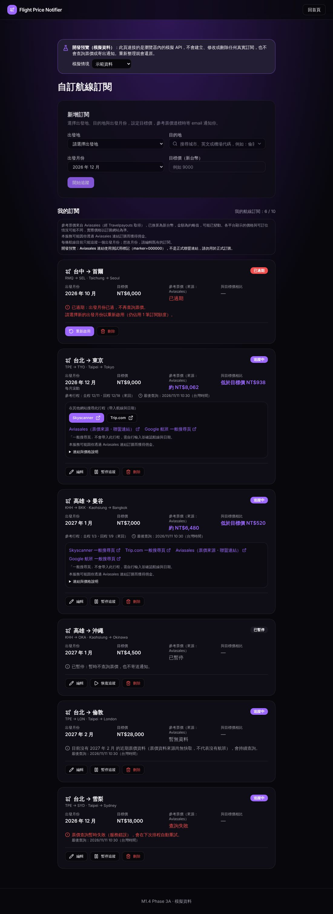
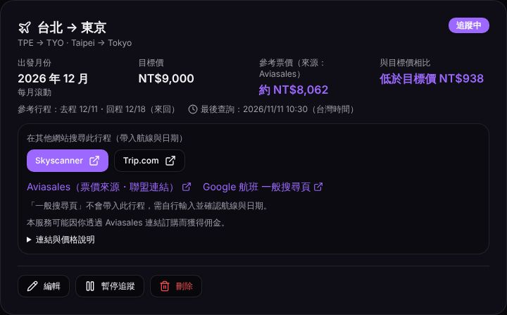
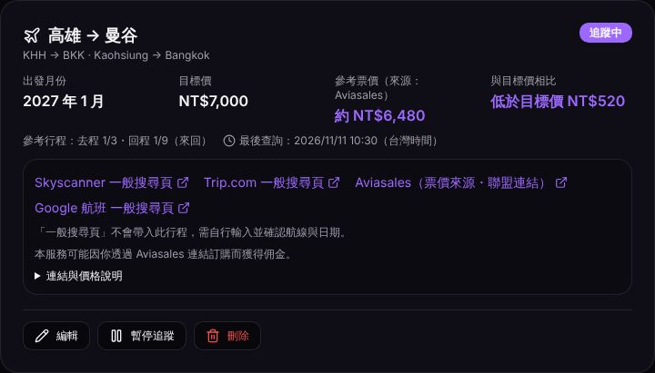
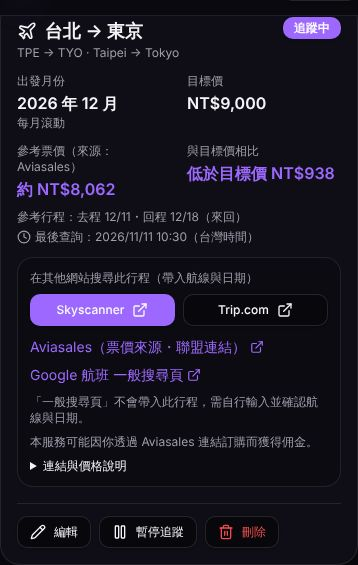
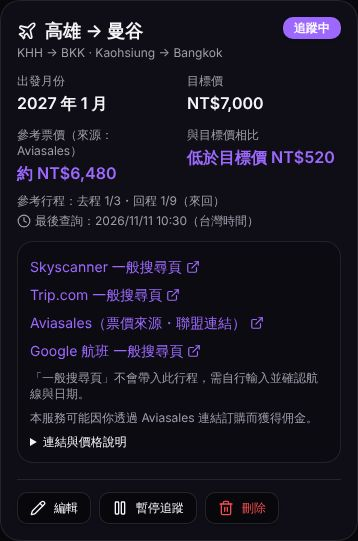
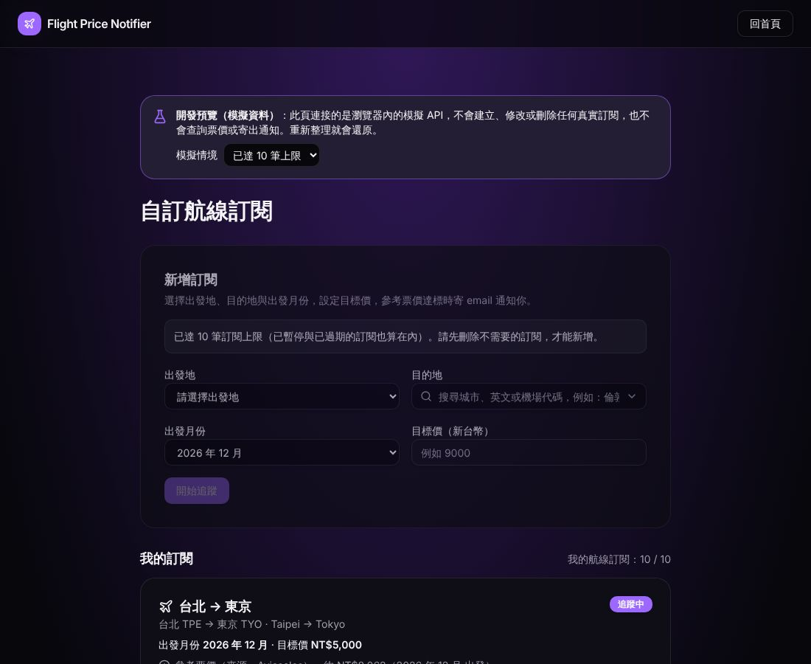
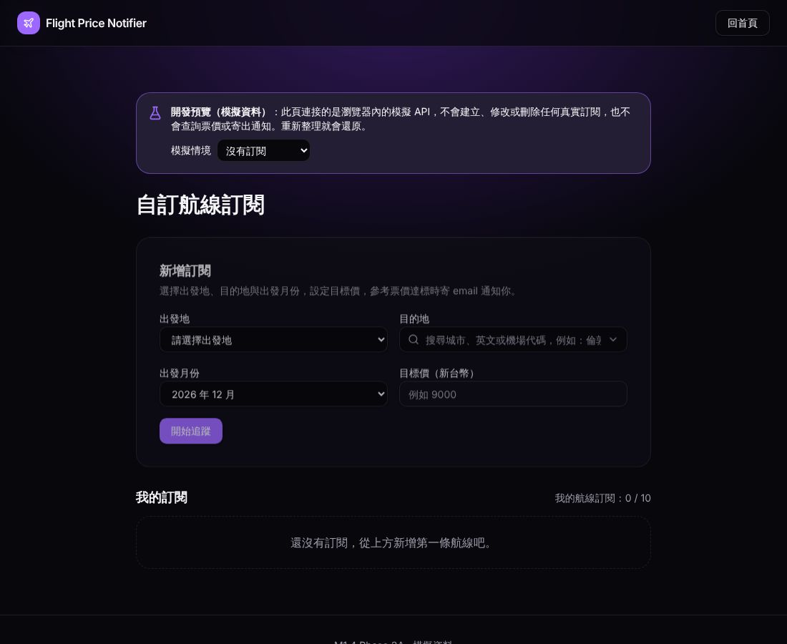
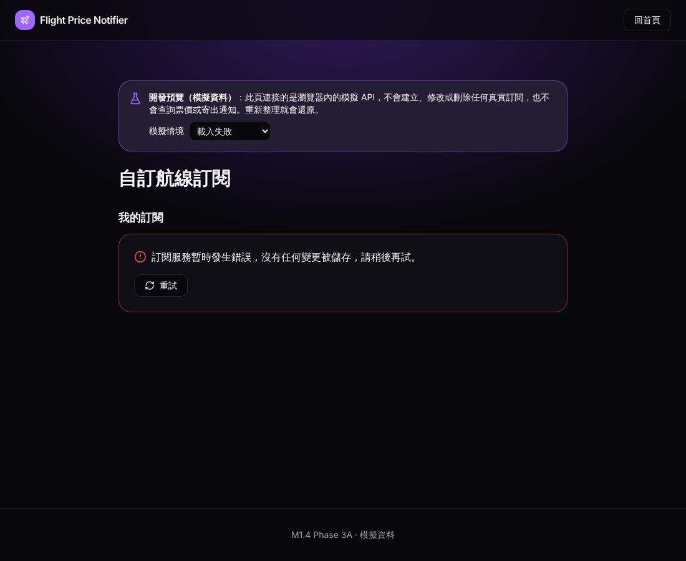
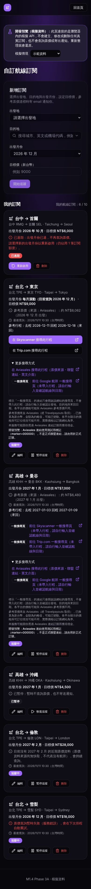

# M1.4 Phase 3A — Frontend integration with mock data

Status: **development and Vercel-preview only.** Nothing calls the subscriptions API, AWS, the
fare check or Resend. Production builds don't contain any of this code (checked by building with
`VERCEL_ENV=production` and searching the bundle).

## 1. What the user sees

Two routes, both compiled in only when `VITE_M14_PROTOTYPE` is `"true"`. That is the dev server
and Vercel preview builds only (`src/lib/prototype-flag.ts`), which is fail-closed:

| Route | Login | Purpose |
|---|---|---|
| `/app/subscriptions` | Yes. Same `appLoader` as `/app` (Supabase session, redirect to `/signin`) | The signed-in workflow. `/app` shows a 「試用自訂航線訂閱（開發預覽・模擬資料）」 button in these builds only |
| `/prototype/subscriptions` | No | The same page for reviewers without an account. It replaces the Phase 1A prototype page |

Every page has a banner: 「開發預覽（模擬資料）… 不會建立、修改或刪除任何真實訂閱，也不會查詢票價或寄出通知」.
The banner also has a **模擬情境** selector: 示範資料, 沒有訂閱, 已達 10 筆上限, 載入失敗, 登入過期.

The workflow:
- **Places:** origins TPE, KHH and RMQ; all 95 destinations through the Phase 1A searchable picker.
- **Months:** the next 12 months, defaulting to next month.
- **Legacy rows:** the M1 rolling row stays rolling until a month is chosen, and can't go back.
- **Limit:** 10 records in total. Paused and expired rows count. Creating is disabled at the
  limit, with an explanation.
- **Row actions:** pause, resume, edit (target, month or route), reactivate an expired row, and
  delete with confirmation.
- **Loading:** a spinner and skeletons.
- **Empty:** a prompt to add the first route.
- **Errors:** a load error with 重試; a 401 with 重新登入; a write error shown above the list.
  The form keeps what was typed, and a `conflict` reloads the list.
- **Busy:** the row or form being saved is disabled while its request runs.

- **Several departure months per route (R-MM-1, 2026-11-12).** Each month is its own
  subscription with its own `id` and card; the cards' accessible names include the month
  (「高雄 → 東京・2027 年 1 月」). The page says so: 「同一航線可以分別追蹤不同的出發月份，每個月份各算
  1 筆訂閱。」 Design: [m1.4-r-mm-1-multi-month.md](m1.4-r-mm-1-multi-month.md).

**Card layout (review update).** Each card leads with the route and status badge, then a fact
grid: two columns on phones, four on desktop.

| 出發月份 | 目標價 | 參考票價（來源：Aviasales） | 與目標價相比 |
|---|---|---|---|
| 2026 年 12 月 (+「每月滾動」 for legacy rows) | NT$9,000 | 約 NT$8,062 | 低於目標價 NT$938 / 等於目標價 / 高於目標價 NT$X |

- When no amount is shown, the fare cell reads 尚未查詢 / 暫無資料 / 查詢失敗 / 已暫停 / 已過期 /
  暫不顯示, the comparison reads 「—」, and the explanation sits under the grid.
- The comparison describes the reference fare only. It never says a notification was sent.
- Below the grid, one compact line gives the trip dates and 「最後查詢」.
- **Links block.**
  - Itinerary links are two short buttons, 「Skyscanner」 and 「Trip.com」, under 「在其他網站搜尋此行程（帶入航線與日期）」.
  - The labelled affiliate link 「Aviasales（票價來源・聯盟連結）」 and the affiliate disclosure are
    always visible.
  - General search pages read 「{平台} 一般搜尋頁」, with a visible line 「「一般搜尋頁」不會帶入此行程，需自行輸入並確認航線與日期。」.
  - The full disclaimer, the general-page note and the language note are under a collapsed
    「連結與價格說明」.
  - Visible link texts are short. Each link's accessible name is the builder's full label plus
    「（另開新視窗）」.
- **Page-level notes**, shown once above the list: the full disclaimer, the affiliate
  disclosure, the one-month-per-route note and, in mock mode only, the test-marker notice.
- **Actions** (編輯, 暫停/恢復追蹤, 刪除) sit on a separate row of named buttons on every card.
- **Height:** compared with the first version, mobile cards with links went from roughly 740–845
  px to 541–565 px, and desktop cards from about 540–550 px to 411–447 px. No horizontal overflow
  at 390 px or 1100 px.

Fare presentation (active rows only; a paused or expired row shows its state instead):

| Mock `fare_check` | Shown |
|---|---|
| `ok` with a positive whole TWD amount | 參考票價 「約 NT$8,062」, the comparison with the target, 「參考行程：去程 12/11・回程 12/18（來回）」, 「最後查詢：2026/11/11 10:30（台灣時間）」, the links block |
| `ok` with 0, a negative or fractional amount, or a non-TWD currency | Treated as an error: 「票價資料異常，暫不顯示金額…」. **Never NT$0** |
| `no_data` | 「目前沒有 {月份} 的近期票價資料（票價資料來源尚無快取，不代表沒有航班），會持續查詢。」 + last checked; no amount, no links |
| `error` | 「票價查詢暫時失敗（服務錯誤），會在下次排程自動重試。」 + last checked; no amount, no links |
| `null` | 「尚未查詢 {月份} 的票價，會在下次排程查詢。」 (new rows, and rows whose route or month changed) |

Search links:
- They use the Phase 2B-2 contract, ported to TypeScript (`src/lib/m14/search-links.ts`). It is
  checked against the **same golden-vector file** as the Python builder.
- Itinerary links: Skyscanner (primary) and Trip.com (secondary) are buttons. The labelled
  Aviasales affiliate link and Google Flights are visible text links (see the card layout above).
- General search pages say 「一般搜尋頁」 in their visible text, with the full label
  「前往 {平台} 一般搜尋頁（未帶入行程，請自行輸入並確認航線與日期）」 as their accessible name. A note
  says they don't carry the itinerary and that prices may differ from the Aviasales reference
  fare. This applies to unverified codes, bad dates and Google.
- **Fail closed:** without a valid Aviasales marker, the row shows 「已查到參考票價，但目前無法提供
  Aviasales 聯盟連結，因此暫不顯示金額與搜尋連結。」 and no links at all.
- Phase 3A passes the obvious **test marker `000000`**, and only in mock mode. The page notes
  then say 「開發預覽：Aviasales 連結使用測試用標記（marker=000000），不是正式聯盟連結」.
  **No production affiliate link is enabled.**
- Links open in a new tab with `rel="noopener noreferrer"` and a visually hidden 「（另開新視窗）」.

### Screenshots (mock data, 2026-11-11, Asia/Taipei)

| | |
|---|---|
| Desktop, demo scenario |  |
| Card with itinerary links (TPE-TYO), desktop |  |
| Card with general search pages (KHH-BKK, codes unverified), desktop |  |
| Card with itinerary links, mobile (390 px) |  |
| Card with general search pages, mobile |  |
| Limit reached |  |
| Empty |  |
| Load error |  |
| Mobile (iPhone 13, 390 px), whole page, no horizontal overflow |  |

## 2. Mock integration architecture

```
M14Subscriptions page (route, banner, auth header)
        │ client: SubscriptionsClient            marker: "000000" (mock only)
        ▼
SubscriptionsManager ── TanStack Query (list) + mutations (create/update/remove)
        │                     │
        │                     ▼
        │      SubscriptionsClient interface (src/lib/m14/api.ts)
        │         ├─ MockSubscriptionsClient (src/lib/m14/mock-client.ts)   ← Phase 3A
        │         └─ HttpSubscriptionsClient (Phase 3B, not written)
        ▼
fareView (src/lib/m14/fare-view.ts) ── fareDisplay (fare-status.ts) + buildSearchLinks (search-links.ts)
        ▼
SubscriptionItem / RouteForm / DestinationPicker (Phase 1A components, kept) + SearchLinks
```

- `SubscriptionsClient` mirrors the API contract: `list()` (§4.1), `create()` (§4.2),
  `update(route, patch)` (§4.3, `if_updated_at` always sent) and `remove(route, ifUpdatedAt)`
  (§4.4). Errors are `ApiError(code, status)` with the §9 codes. `apiErrorMessage()` turns
  them into Traditional Chinese without echoing server text.
- `MockSubscriptionsClient` keeps fake rows in memory and applies the contract's rules:
  - validation order and codes;
  - one subscription per (route, fixed month) plus one rolling row per route (R-MM-1), addressed by `id`;
  - the strict 10-record limit;
  - a legacy rolling row becomes fixed only when a month is chosen;
  - atomic route change;
  - optimistic concurrency (`conflict`);
  - derived `status`, `effective_month` and `month_mode`;
  - `fare_check` reset when the route or month changes.

  It never calls `fetch`. Tests stub `fetch` and fail if it's called.
- `parseFareCheck()` validates fare data from the API defensively before anything is shown.
- **Production isolation**, four independent layers:
  1. The routes are compiled in only when `VITE_M14_PROTOTYPE` is `"true"`. `vite.config.ts`
     forces it to `"false"` whenever `VERCEL_ENV=production`, so `/app/subscriptions` and
     `/prototype/subscriptions` fall through to the 404 route, including on direct navigation.
  2. The page renders the 404 page if it is ever mounted without the flag.
  3. `MockSubscriptionsClient` refuses to be constructed outside preview builds and tests.
  4. `createSubscriptionsClient()` has no fallback: outside preview builds it throws
     `ClientUnavailable` instead of returning mock data.

  The mock keeps state only in memory: no localStorage, no sessionStorage, no network.
- The Phase 1A in-memory prototype page is replaced. Its reducer and validation
  (`subscriptions.ts`) now back the mock client, so the rules live in one place.

## 3. API contracts needed for backend integration (Phase 3B)

| Need | Contract | State |
|---|---|---|
| `GET/POST /subscriptions`, `PATCH/DELETE /subscriptions/{id}` | [subscriptions API](api/m1.4-subscriptions-api.md) §4 | Implemented in `aws/lambdas/flight-subscriptions-api/` (Phase 1B); **not deployed, no routes** (B3) |
| `fare_check` on each subscription | §3.4 (`kind`, `checked_at`, `cheapest_twd`, `currency`, `depart_date`, `return_date`, airports) | Produced by the Phase 2A fare check (`status.api_view`). The proposed `fare_check` table and the API's `BatchGetItem` read are **not built** |
| `limits`, `months` in the list response | §4.1 | Implemented in Phase 1B |
| CORS `PATCH`, `DELETE` | §2 | In the Phase 1B template; not deployed |
| Aviasales marker for the page | Phase 2B-2 §2.3 | Needs a public build-time value (e.g. `VITE_TP_MARKER`, the partner ID, never `TP_TOKEN`), set only after the dashboard attribution check (B6) |

## 4. Tests

- Frontend (Vitest): **204 pass**, up from 153 on `main`.
  - Removed: the 16 Phase 1A prototype-page tests.
  - Added 67:
    - `M14Subscriptions.test.tsx` (29 tests): origin/destination selection, months, legacy
      rows, the limit, active/paused/expired, edit/route change/delete, loading/empty/error/401,
      no-data vs error vs fare, the card's primary facts and the target comparison in both
      directions, required notices, link kinds and labels, fail-closed without a marker, URL
      privacy, auth compatibility, mobile layout, named action buttons, and that no browser
      storage is written;
    - `search-links.test.ts` (12 tests): the shared golden vectors and 3 × 95 routes;
    - `mock-client.test.ts` (13 tests): contract semantics and fare parsing;
    - `production-isolation.test.tsx` (10 tests): direct URLs fall through to 404 in a
      production build, the M1 routes are unchanged, the mock refuses to construct, there is no
      client fallback, and the page shows a 404 with no test marker;
    - `production-bundle.test.ts` (2 tests): builds the real bundle with
      `VERCEL_ENV=production` and checks there are no Phase 3A routes, scenarios, mock strings or
      `marker=000000`, while the M1 dashboard is still there; the same check on a preview build
      finds the Phase 3A code;
    - `app-routing.test.tsx` (1 test): the route guard.
  - Changed: `fare-status.test.ts` (reference wording).
- `tsc --noEmit` clean. `vite build` OK.
- Python: **385 pass**, unchanged.
- ESLint: baseline on `main` is 103 errors and 7 warnings; this branch has the same counts.
  **New: 0 errors, 0 warnings.** All baseline errors are `prettier/prettier` and `prefer-const`
  in files this PR doesn't touch.
- Mobile: Playwright at 1100 px and on iPhone 13 (390 px) shows no horizontal overflow (0 px).

## 5. Remaining Phase 3B tasks

1. Write `HttpSubscriptionsClient`: Supabase bearer token via the existing `authedFetch`,
   `VITE_FLIGHT_API_URL`, §9 error mapping, `network_error` for fetch failures. Contract tests
   share fixtures with `aws/tests/test_m14_subscriptions_api.py`.
2. Choose the client by configuration, with mock as the default until the cutover. Keep the
   page behind the flag until B3 is done.
3. Build the `fare_check` table and the API read, so the page gets real fare data.
4. Add a page marker (`VITE_TP_MARKER`) after the B6 attribution check, and remove the
   test-marker notice for real data.
5. Replace the M1 `/app` plan cards with the new page at cutover; the legacy `POST /subscribe`
   path is handled by the API (§8.2).
6. Run the test-inbox render and preview checks of spec §7.2 against real preview data.
7. R-MM-1 is implemented in code ([m1.4-r-mm-1-multi-month.md](m1.4-r-mm-1-multi-month.md)).
   The HTTP client must use `id` in paths and needs the B4 Stage C re-run before deployment.

## 6. Deployment blockers

- **B3 (deployment order):** the subscriptions API routes, quota table and fare-check changes
  must ship together in one reviewed change set, and the fare check must support months, pause,
  expiry and the quota first. Not started. Phase 3A doesn't change it.
- **B6 (links):** still open.
  - Skyscanner site-terms review.
  - This project's marker, set at deploy time and confirmed in the Travelpayouts dashboard.
  - Manual §7.3 verification of `verified_codes`, including Skyscanner TWD and whether TPE
    means Taoyuan only.
  - Approval of the new wording.
  - A decision on the unmarked M1 email.
- B1, B2 and B5 (rounds 2–3) remain as recorded in the plan.

## 7. Production

Unchanged. No AWS, DynamoDB, Lambda, API Gateway, EventBridge, Resend, Supabase or Vercel
settings were touched. No B5 data and no domain. The production bundle doesn't include the
Phase 3A routes or code.
